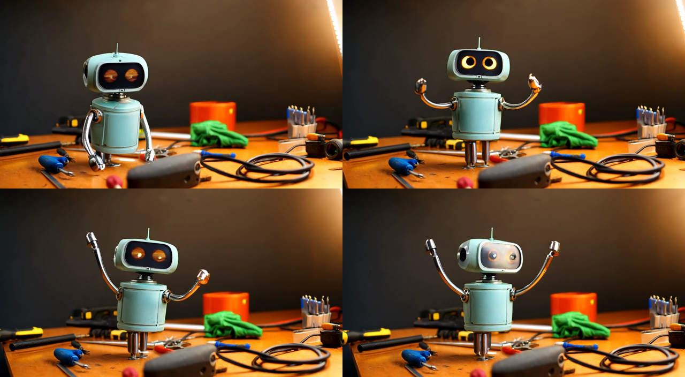
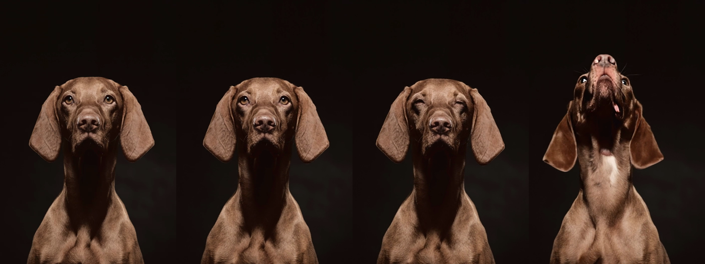
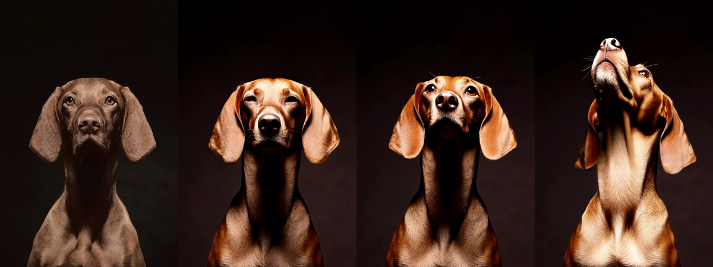
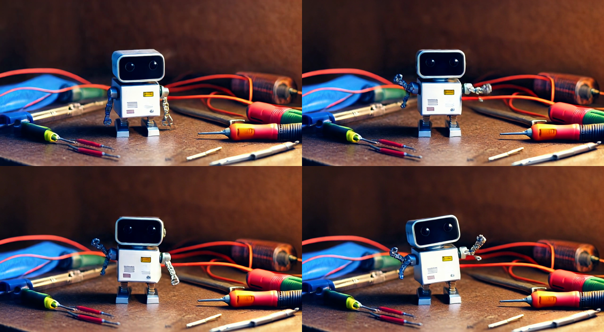

# Wan 2.2 video generation on a Tesla V100

**A 2017 Tesla V100 (32 GB, Volta) makes 5-second, 720p videos with Wan 2.2 TI2V-5B** -- from a text prompt or from
a photo -- in about 20-30 minutes a clip, or in 1-6 minutes with FastWan 2.2's 3-step version. The V100 has no fast
bf16 and no FlashAttention, so the recipe below is what makes it work: an fp16 video model, an fp32 text encoder
that is dropped before the video model loads, and an fp16 video decoder. One script: [`wan_clip.py`](wan_clip.py).



*Text-to-video, 1280x704, 5 s, 50 steps: "A small sarcastic desk robot with glowing round eyes wakes up on a cluttered
workbench full of tools and wires, looks around and stretches its little metal arms, warm cinematic lighting, shallow
depth of field." ([video](clips/robot-50step.mp4))*

## Times

One Tesla V100-PCIE-32GB, every clip 121 frames (5 s at 24 fps) unless noted; the time includes loading the models.

| Clip | Recipe | Total time | Making the video | Decoding it |
|---|---|---|---|---|
| Robot, text-to-video, 1280x704 | Wan 2.2, 50 steps, fp32 decoder | 30 min 24 s | ~25 min | ~5 min |
| Robot, text-to-video, 1280x704 | FastWan 2.2, 3 steps, fp32 decoder | 6 min 4 s | ~45 s | ~4 min 40 s |
| Dog, image-to-video, 704x1056 | Wan 2.2, 50 steps, **fp16 decoder** | **19 min 24 s** | | |
| Dog, image-to-video, 704x1056 | FastWan 2.2, 3 steps, **fp16 decoder** | **2 min 7 s** | | |
| Robot, text-to-video, 832x480, 2 s (49 frames) | FastWan 2.2, 3 steps, fp16 decoder | 52 s | | |

Loading takes about 40-50 s of each run (the text encoder in fp32, then the video model). Peak GPU memory was 21.5 GB
in the runs shown here -- the fp32 text-encoder step; generation itself needs less. Decoding a 5 s clip of about 0.9
megapixels took about 280 s with the decoder in fp32 and about 75 s in fp16 (two FastWan clips of similar size,
1280x704 and 1120x832), with no visible artifacts in fp16.

## Wan 2.2 or FastWan 2.2?

[FastWan 2.2](https://huggingface.co/FastVideo/FastWan2.2-TI2V-5B-FullAttn-Diffusers) (FastVideo, Hao AI Lab) is the
same model distilled to 3 steps without classifier-free guidance -- about 30 times less model work. On the V100 it
was **5-10 times faster in total**, but:

- **From a photo it does not keep the subject.** Starting from a portrait of a vizsla, Wan 2.2 (50 steps) kept the
  same dog, blinking and then looking up; FastWan turned it into a different, orange-and-white dog after the first frame.

  
  

  *Image-to-video, 704x1056, 5 s: "Static camera, studio portrait. A brown short-haired hunting dog sits against a
  dark studio background, blinks, tilts its head slightly to one side, its long ears moving gently, then looks up.
  Soft studio lighting." Videos: [Wan 2.2](clips/dog-50step.mp4), [FastWan](clips/dog-fastwan.mp4).*
- **Its colours are punchier and its detail softer** -- the usual look of a few-step distilled model.

  

  *The robot prompt with FastWan: a different robot, but stable, in 6 minutes instead of 30
  ([video](clips/robot-fastwan.mp4)).*

Use FastWan to try prompts in a minute or two; use Wan 2.2's 50 steps for the clip you keep, and always for a photo.

## What makes it work on a V100

- **fp16, not bf16.** Wan is trained in bf16; Volta has no fast bf16 (PyTorch emulates it, many times slower). The
  video model runs in fp16 with no NaNs or visible problems in any run here.
- **The umT5 text encoder in fp32, then gone.** T5-family encoders can overflow in fp16, so the encoder (about
  5.7B parameters, ~23 GB in fp32) runs once in fp32 for the prompt and the negative prompt, and is deleted before
  the video model loads. The prompt is embedded the way diffusers' `WanPipeline` does it (padded to 512, zeros after
  the real tokens), by hand, so the optional `ftfy` package isn't needed.
- **Straight onto the GPU.** The machine has 16 GB of RAM, so nothing is assembled in system memory first
  (`device_map`, `low_cpu_mem_usage`).
- **The decoder in fp16 and tiled** (`--vae-fp16 --tile`): tiling keeps a 720p x 121-frame decode within memory,
  fp16 makes it about 4x faster (checked for artifacts by eye, not compared frame by frame).
- **FastWan's sampler, inside diffusers.** FastVideo runs FastWan with its own pipeline; [`wan_clip.py`](wan_clip.py)
  has a small DMD sampler that plugs into diffusers' Wan pipelines instead -- at timesteps 1000, 757 and 522 (from
  FastVideo's inference script) the model's flow prediction gives the clean video (x0 = x_t - t/1000 * v), which is
  noised again to the next timestep.
- Attention is PyTorch's SDPA (no FlashAttention on Volta).

## Rerun it

```sh
# models (Hugging Face): Wan-AI/Wan2.2-TI2V-5B-Diffusers (34 GB);
# for --fast, only the transformer of FastVideo/FastWan2.2-TI2V-5B-FullAttn-Diffusers (10 GB)
export CUDA_VISIBLE_DEVICES=<the V100>
python wan_clip.py --model Wan2.2-TI2V-5B-Diffusers --prompt "..." --out clip.mp4 \
    --width 1280 --height 704 --tile --vae-fp16                       # 50 steps, guidance 5
python wan_clip.py --model Wan2.2-TI2V-5B-Diffusers --fast FastWan2.2-TI2V-5B-FullAttn-Diffusers --steps 3 \
    --image photo.jpg --prompt "..." --out clip.mp4 --width 704 --height 1056 --tile --vae-fp16
```

Tested with torch 2.8.0+cu126, diffusers 0.41.0, transformers 5.18.0, ffmpeg on the PATH. Width and height should be
multiples of 32; frames 4n+1.

## Limits

- One V100, one seed per clip, and the quality judgements are by eye.
- Times grow with the picture size and length: 704x1056 is cheaper than 1280x704.
- The FastWan comparison is two clips; it matches what distilled models usually do, but it is not a measurement.
- Wan 2.2 also has a larger 14B model, which was not tried here.

## Credits

The dog clips start from "Vizsla dog portrait" by hekovs on
[Pixabay](https://pixabay.com/photos/animals-vizsla-hunting-dog-portrait-9533774/) (Pixabay Content License; the photo
itself is not included here -- download it from the link to rerun). Models: Wan 2.2 TI2V-5B by Wan-AI (Apache-2.0),
FastWan 2.2 TI2V-5B FullAttn by FastVideo (Apache-2.0). See [CREDITS.md](CREDITS.md).

**AI assistance:** the script, the runs and this write-up were done with an AI coding assistant (Claude, by
Anthropic). A person directed the work and chose what to test.

Code: MIT (see [LICENSE](LICENSE)). The clips are outputs of the models above.
